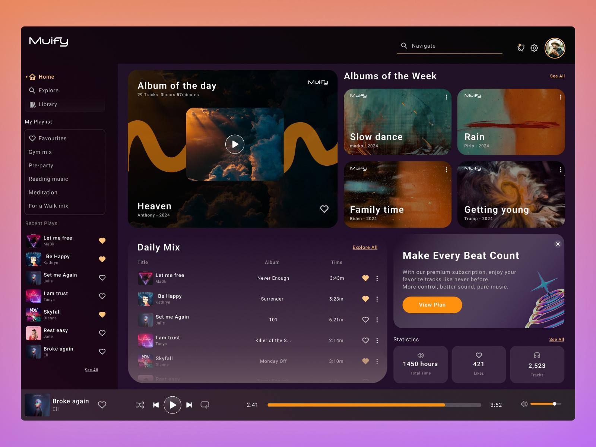

# MuiFy

Музична платформа: React + TypeScript (Vite) на фронтенді, Node.js + Express + TypeScript на бекенді.



## Запуск

```bash
npm run install:all   # встановити залежності (перший раз)
npm run dev           # API на http://localhost:4000, клієнт на http://localhost:5173
npm run build         # перевірка типів і збірка обох частин
npm test              # тести сервера (Vitest + supertest) і клієнта (Vitest + jsdom + Testing Library)
npm run typecheck     # tsc для сервера (разом із тестами) і клієнта
npm start             # продакшн: API + зібраний клієнт на одному порту (PORT, типово 4000); спершу npm run build
```

CI: `.github/workflows/ci.yml` (Node 22, `npm ci` у корені/server/client, typecheck, build, tests, smoke-тест `npm start` — `/api/status`, `/`, SPA-fallback, CSP, `sw.js`; окремий job збирає й запускає Docker-образ). Секрети не потрібні: тести використовують in-memory фейк Firebase і локальний фейковий Jamendo API.

## Можливості цієї версії

- **Статистика на Home** — реальні дані слухача: час прослуховування («3 h 20 min»), лайки (треки + альбоми), кількість різних прослуханих треків (`GET /api/stats`, лише для залогінених / local; гостям — картка «Sign in to see your listening stats»). Рахується з історії (останні 2000 прослуховувань).
- **Сторінка артиста** `/artist/:id` (`GET /api/artists/:id`): Jamendo (`jr123` → `/artists`, `/tracks?artist_id`, `/albums/tracks?artist_id`) або seed (`sa-<ім'я>`). Імена артистів клікабельні в рядках треків, картках альбомів, на сторінці альбому, у плеєрі, Recent Plays і статистиці (окремі посилання; клік по рядку й далі запускає трек).
- **Персональні рекомендації** (`GET /api/recommendations`, `/api/tracks/daily-mix`): Daily Mix з улюблених/найчастіше слуханих артистів і жанрів (Jamendo: `artist_id` + `fuzzytags`), без нещодавно прослуханого, детермінований на користувача й день, кеш на користувача (1 год або до зміни смаку). Рядок «Because you liked …» на Home, якщо даних достатньо. Гостям — загальний мікс.
- **Плейлисти**: опис, зміна порядку (drag-and-drop або ⋮ → Move up / Move down / to top / to bottom), публічне посилання `/p/:shareId` (read-only, відкривається і гостями). Firebase: індекс `sharedPlaylists/{shareId} → { ownerUid, playlistId }` (читає лише сервер; правила RTDB і далі забороняють клієнтський доступ); local: `shareId` у самому плейлисті. Вимкнення посилання → 404.
- **Гарячі клавіші** (поза текстовими полями): Space, Shift+←/→, ←/→ (±5 с), ↑/↓ (гучність), M, L, `/`, `?` (довідка; також у меню Settings).
- **Українська та англійська** — власний легкий i18n (`client/src/i18n/`): типізовані словники `en.ts` / `uk.ts` (однакові ключі перевіряють і TypeScript, і тест), `t()` з інтерполяцією `{name}` і множиною через `Intl.PluralRules` (uk: one/few/many/other), `<Trans>` для вставок із розміткою. Мова за замовчуванням — з браузера (`uk*` → українська, інакше англійська); перемикач у меню Settings і на `/account`; зберігається в профілі (`PATCH /api/me { language }`) для залогінених і в `localStorage` (`muify:lang`) для всіх. `<html lang>` оновлюється. Перекладено весь UI, aria-labels, тости, помилки Firebase Auth, порожні стани, назви жанрів і вбудованих плейлистів; дати/тривалості/числа — через `Intl`. Назви треків/альбомів/артистів не перекладаються. Листи Firebase (підтвердження, скидання пароля) — мовою інтерфейсу (`auth.languageCode`).
- **Стежити за артистами + сповіщення**: кнопка «Стежити / Follow» на сторінці артиста (`PUT/DELETE /api/artists/:id/follow`), вкладка Library → «Виконавці» (`GET /api/me/follows`). Дзвіночок у шапці (лише для залогінених і в local mode): нові релізи артистів, за якими стежите, + привітання; лічильник непрочитаних, «позначити прочитаним / усі», клік → сторінка альбому (`GET /api/notifications`, `POST /api/notifications/read { ids } | { all: true }`). Сервер перевіряє релізи ліниво під час запиту: для користувача не частіше ніж раз на 6 год (і одразу після нового follow), список релізів кожного артиста кешується на 6 год спільно для всіх (Jamendo `/albums?artist_id=…&datebetween=<дата follow>_<сьогодні>`, до 20 артистів за запит), після помилки — пауза 10 хв. Сповіщення — це альбоми, випущені в день follow або пізніше. У seed-режимі (без Jamendo) найновіший демо-альбом артиста показується як «новий реліз» (з позначкою «демо»). Текст сповіщень не зберігається — клієнт рендерить його потрібною мовою.
- **Пошук** `/search?q=&tab=` — вкладки Усе / Треки / Альбоми / Виконавці / Ваші плейлисти (`GET /api/search?q=&type=all|tracks|albums|artists|playlists`; виконавці — Jamendo `/artists?namesearch=`, у seed — за іменами з каталогу). Нещодавні пошуки: для акаунта — на сервері (`GET/POST/DELETE /api/me/searches`, до 10), для гостей — `localStorage`; можна прибрати один або очистити всі. Enter у пошуку в шапці відкриває `/search` з будь-якої сторінки, крім тих, що мають власний фільтр списку (бібліотека, альбом, артист, спільний плейлист, альбоми тижня) — там поле й далі фільтрує список; на Explore поле фільтрує живо, Enter — повний пошук. Клавіша `/` як і раніше фокусує пошук.
- **Плеєр**: таймер сну (15/30/45/60 хв або «після цього треку»; лишок часу на кнопці; гучність плавно стихає за останні ~10 с, потім пауза), швидкість 0.75×–1.5× (зберігається в браузері; працює і для імітованого відтворення), панель «Текст пісні», якщо Jamendo має текст (`include=lyrics` у кожному запиті `/tracks` → `track.hasLyrics`; `GET /api/tracks/:id/lyrics` → `{ lyrics: string | null }`, текст очищується від HTML і показується як plain text). Кнопка текстів прихована, коли тексту немає.
- **Рекомендації оновлюються після лайків**: серверний кеш користувача скидається при зміні лайків, клієнт перезапитує `/api/recommendations` через 1,5 с після останнього лайка (один запит на серію).
- **Черга**: імена артистів — посилання. **Плейлисти**: зміна порядку перетягуванням за ручку працює й на сенсорних екранах (pointer events), ручка також реагує на ↑/↓/Home/End; пункти меню ⋮ «Перемістити вгору/вниз…» залишилися.
- **PWA**: `manifest.webmanifest`, іконки (SVG + PNG 192/512 + maskable + apple-touch), service worker (`sw.js` генерується під час збірки плагіном `client/vite-pwa.ts`): кешує лише оболонку застосунку (index.html, хешовані JS/CSS, іконки, маніфест), ніколи — `/api` і аудіопотоки; навігація — network-first з офлайн-фолбеком на кешовану оболонку. Реєструється тільки в продакшн-збірці.

## Структура

- `client/` — React-застосунок (компоненти в `src/components`, стан у `src/store`, переклади в `src/i18n`).
- `server/` — Express API (`/api/albums`, `/api/artists`, `/api/playlists`, `/api/shared`, `/api/tracks`, `/api/recommendations`, `/api/history`, `/api/stats`, `/api/player`, `/api/me`, `/api/search`, `/api/notifications`). У продакшні ще й роздає `client/dist` (`server/src/static.ts`), заголовки безпеки й rate limit — `server/src/security.ts`, правила сповіщень — `server/src/notifications.ts`. Тести — у `server/test/`. Каталог (seed або Jamendo) — у пам'яті, спільний для всіх. Стан користувача (лайки, власні плейлисти, історія, остання позиція/трек/гучність, профіль) — окремо для кожного користувача, див. «Акаунти».

## Акаунти (Firebase)

- **Режим `firebase`** (заповнені `FIREBASE_DATABASE_URL` + сервісний ключ у `server/.env`, і Firebase web-конфіг у `client/.env.local`): вхід через Email/пароль або Google (Firebase Auth у браузері). Сервер перевіряє ID-токен (`Authorization: Bearer …`, `firebase-admin`) і зберігає дані у Realtime Database під `users/{uid}/…` (`profile`, `likes`, `playlists`, `history`, `player`, `meta`). Гості можуть слухати й переглядати каталог; збереження вимагає входу (API відповідає 401).
- **Режим `local`** (Firebase не налаштовано): як раніше — без входу, один користувач, стан у `server/data-store/user-state.json` (або `MUIFY_DATA_DIR`). Сервер один раз пише попередження в лог.
- Режим видно в `GET /api/status` → `auth`.
- Браузер ніколи не читає RTDB напряму: `database.rules.json` забороняє будь-який клієнтський доступ (застосувати: Firebase Console → Realtime Database → Rules, або `npx firebase-tools deploy --only database --project <id>`).
- Емулятори: `firebase.json` (Auth :9099, RTDB :9000, потрібна Java 11+), змінні `FIREBASE_AUTH_EMULATOR_HOST` / `FIREBASE_DATABASE_EMULATOR_HOST` на сервері та `VITE_USE_FIREBASE_EMULATORS=true` у клієнті.
- Перевірки: офлайн-перевірка Firebase-режиму (колишній `scripts/auth-smoke.ts`) тепер — Vitest-тести `server/test/*.firebase.test.ts` (входять у `npm test`). Живі перевірки з реальними обліковими даними (не в CI): `cd server && npx tsx scripts/firebase-live-check.ts http://localhost:5174` (реальний проєкт, створює й видаляє тестових користувачів `muify-test-*@example.com` і їхні `sharedPlaylists`), `npx tsx scripts/firebase-leftovers.ts`.
- `design/` — макет.
- `.claude/agents/muify-builder.md` — Claude Code агент для розробки платформи за макетом.

## Deploy

Нічого не розгортається автоматично; нижче — як запустити продакшн-збірку.

### Без Docker

```bash
npm run install:all
npm run build                 # server/dist + client/dist (з sw.js)
PORT=8080 npm start           # NODE_ENV=production: Express віддає client/dist і /api на одному порту
```

У продакшні Express роздає `client/dist`: хешовані `/assets/*` — `Cache-Control: public, max-age=31536000, immutable` (відсутній файл → 404, а не index.html), `index.html`, `sw.js`, маніфест — `no-cache`, решта шляхів поза `/api` → `index.html` (SPA). Вмикається `NODE_ENV=production` (так робить `npm start`) або `SERVE_CLIENT=true`.

### Docker

```bash
docker build -t muify \
  --build-arg VITE_FIREBASE_API_KEY=… --build-arg VITE_FIREBASE_AUTH_DOMAIN=<project>.firebaseapp.com \
  --build-arg VITE_FIREBASE_PROJECT_ID=… --build-arg VITE_FIREBASE_APP_ID=… .

# local mode (без акаунтів), стан — у томі:
docker run -p 8080:8080 -e JAMENDO_CLIENT_ID=… -v muify-data:/app/server/data-store muify

# Firebase mode: ключ сервісного акаунта змонтовано як файл (read-only)…
docker run -p 8080:8080 \
  -e JAMENDO_CLIENT_ID=… \
  -e FIREBASE_DATABASE_URL=https://<project>-default-rtdb.<region>.firebasedatabase.app \
  -e FIREBASE_SERVICE_ACCOUNT_PATH=/run/secrets/firebase-sa.json \
  -v /secure/path/firebase-sa.json:/run/secrets/firebase-sa.json:ro \
  -e TRUST_PROXY=1 muify
# …або (PaaS) через змінну: -e FIREBASE_SERVICE_ACCOUNT_JSON="$(base64 -w0 firebase-sa.json)"
```

Образ: multi-stage на `node:22-alpine`, у фінальному шарі лише `server/dist`, production-залежності сервера і `client/dist`; процес працює від користувача `node` (не root), `HEALTHCHECK` на `/api/status`, порт 8080. `.dockerignore` не пускає в контекст `.env*`, `*service-account*.json`, `server/data-store`, `node_modules`, збірки. `VITE_FIREBASE_*` — публічна веб-конфігурація Firebase (не секрет; без неї вхід у UI вимкнено). **Секрети** (`JAMENDO_CLIENT_ID`, ключ сервісного акаунта) передаються лише під час запуску — змінними середовища або змонтованими файлами, в образ вони не потрапляють.

### Змінні середовища (сервер)

| Змінна | Призначення |
| --- | --- |
| `PORT`, `HOST` | порт (типово 4000; в образі 8080) і адреса |
| `JAMENDO_CLIENT_ID` | Jamendo API (секрет); без нього — демо-каталог |
| `FIREBASE_DATABASE_URL` + `FIREBASE_SERVICE_ACCOUNT_PATH` або `FIREBASE_SERVICE_ACCOUNT_JSON` | режим акаунтів (Firebase Auth + RTDB); без них — local mode |
| `MUIFY_DATA_DIR` | де local mode зберігає `user-state.json` (типово `server/data-store`) |
| `TRUST_PROXY` | за reverse proxy / балансувальником: `1` (кількість хопів), `loopback`, CIDR… — щоб `req.ip` (rate limit) був реальним клієнтом |
| `FIREBASE_AUTH_DOMAIN` | власний auth-домен Firebase (додається в CSP `frame-src`/`connect-src`) |
| `CSP_IMG_SRC`, `CSP_CONNECT_SRC` | додаткові джерела для CSP |
| `CSP_UPGRADE_INSECURE=true`, `HSTS=true` | лише коли сайт працює через HTTPS |
| `RATE_LIMIT_WRITES` (300/хв), `RATE_LIMIT_ACCOUNT` (20/10 хв), `RATE_LIMIT_SEARCH` (60/хв) | ліміти на IP; `0` вимикає |
| `JSON_BODY_LIMIT` | ліміт тіла JSON (типово `100kb`, більше → 413) |

Клієнт (на етапі збірки): `VITE_FIREBASE_API_KEY`, `VITE_FIREBASE_AUTH_DOMAIN`, `VITE_FIREBASE_PROJECT_ID`, `VITE_FIREBASE_APP_ID`.

### Безпека

- `helmet`: CSP (`default-src 'self'`; скрипти — свої + `apis.google.com` для Firebase popup/redirect; `frame-src` — `*.firebaseapp.com`, `*.web.app`, `accounts.google.com`; `connect-src` — Identity Toolkit / Secure Token; шрифти Google; зображення — `*.jamendo.com`, `*.googleusercontent.com`; медіа — лише свій `/api/.../stream`), `Cross-Origin-Opener-Policy: same-origin-allow-popups` (інакше ламається вхід через Google popup), `nosniff`, `Referrer-Policy`, `frame-ancestors 'none'`; без `X-Powered-By`.
- Rate limiting у пам'яті (на один інстанс): усі POST/PUT/PATCH/DELETE під `/api`, суворіший — видалення акаунта / вихід усюди / експорт, окремий — пошук; відповідь 429 + `Retry-After`.

### Firebase: authorized domains

Firebase Console → Authentication → Settings → **Authorized domains**: додайте домен, на якому працює застосунок (напр. `muify.example.com`; `localhost` там уже є). Для Google-входу через redirect також має бути налаштований `authDomain` (`<project>.firebaseapp.com` або власний домен — тоді вкажіть його в `FIREBASE_AUTH_DOMAIN`, щоб CSP його пропустила). Правила RTDB — з `database.rules.json` (клієнтський доступ заборонено, усе через API).

### PWA

Встановлюється з браузера (Chrome/Edge: «Установити застосунок»). Service worker працює лише на `https://` або `localhost`; після нового деплою сторінка підтягує свіжий `index.html` (network-first), старі кеші видаляються при активації нового `sw.js`.
